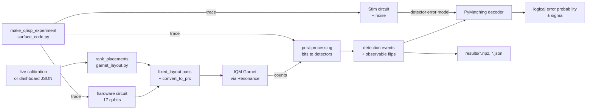
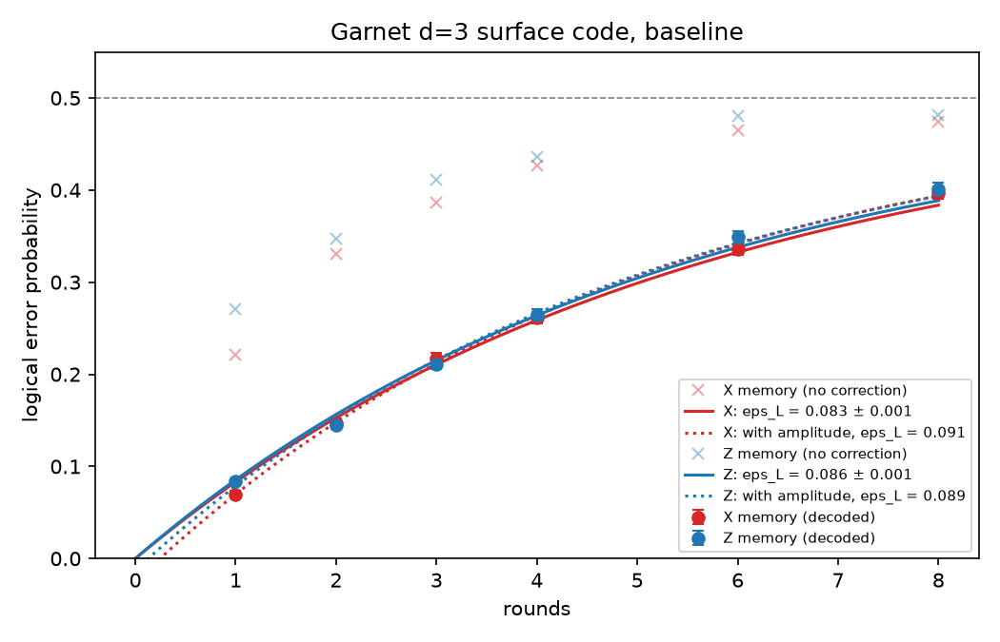

# Build 1 design document: a surface code on IQM Garnet, in Qrisp

Branch: `build-1-qrisp-surface-code` · Team: DuQuantum · IQM QEC Challenge, Duke, Oct 24–25 2026

This document explains everything on this branch for someone who has never
touched quantum error correction. Read it top to bottom once; after that the
sections work as a reference.

---

## 0. The short version

- We wrote our own **surface code generator** in Qrisp (`surface_code.py`). It
  builds the error-correction circuit for any code size, any number of rounds,
  protecting either a bit value (Z) or a phase (X), with or without resetting
  qubits between rounds.
- We proved in simulation that the circuit is correct (`check_surface_code.py`):
  no false alarms, full error-correcting strength, only gates the chip can do.
- We wrote a **placement search** (`garnet_layout.py`) that reads the chip's
  live calibration and finds every way to fit the code on IQM Garnet with
  **zero SWAP gates**. Garnet has exactly one such set of 17 qubits.
- We wired up **real hardware runs, saving, and decoding**
  (`run_on_hardware.py`).
- **First hardware result** (job `01a16f44`, 1 round, 2,000 shots):
  - Without error correction, 22% of shots had the wrong logical value.
  - After decoding, 9.6% ± 0.7% did.
  - So error correction more than halved the error on real hardware.
- **Baseline logical error rate** (job `01a16fb3`; rounds 1, 2, 3, 4, 6, 8 in
  both bases; 5,000 shots each; section 7.2):
  - **\(\varepsilon_L\) = 8.55% ± 0.12% per round (Z memory)**
  - **\(\varepsilon_L\) = 8.33% ± 0.12% per round (X memory)**

  Every improvement gets measured against these two numbers. Lower is better.
- **Biggest error source** is data qubits losing their phase while they wait for
  the ancillas to be measured. The fix to try first is IQM's dynamical
  decoupling option.
- **Teammates:** branch off this branch and follow section 9. It lists the
  exact commands to test an idea and compare it with the baseline.

---

## 1. Background in plain words

### 1.1 Why error correction

A qubit is fragile. Every gate, every measurement, and even just waiting adds a
small chance that its value gets scrambled. On Garnet a two-qubit gate fails
about 0.5% of the time and a readout gives the wrong answer about 2% of the
time. Long computations would be hopeless at those rates.

Error correction stores **one logical qubit** (the information we care about)
spread across **many physical qubits**, and keeps checking it for damage.

### 1.2 Data qubits and ancillas ("watchmen")

The d=3 rotated surface code uses 17 qubits:

| Role | Count | Job |
|---|---|---|
| Data qubits | 9 | Hold the information, together |
| X-check ancillas | 4 | Each checks 2 or 4 neighbouring data qubits for **phase flips** |
| Z-check ancillas | 4 | Each checks 2 or 4 neighbouring data qubits for **bit flips** |

An ancilla never learns the stored information itself. It only learns whether
its neighbours still **agree** with each other (their combined parity). That's
how you can look for damage without destroying what you're protecting.

```
     x:  0    1    2    3    4    5    6
   y=0             X9
   y=1       D0        D1        D2          D  = data qubit
   y=2            Z13       X10       Z14    X9..X12  = X-check ancillas
   y=3       D3        D4        D5          Z13..Z16 = Z-check ancillas
   y=4  Z15       X11       Z16
   y=5       D6        D7        D8          Each ancilla checks its diagonal
   y=6                      X12              data neighbours.
```

The numbers are the qubit indices used everywhere in the code. Index i is
"code qubit i".

### 1.3 Rounds, detectors, decoder

- **Round:** every ancilla does a CZ gate with each of its data neighbours,
  then gets measured. One round = one full health check. We repeat it several
  times.
- **Detector ("alarm"):** a bit that should be 0 if nothing went wrong. Usually
  it compares an ancilla's answer this round with its answer last round, so it
  fires (becomes 1) when something **changed**. A detector that fires with no
  noise at all would be a bug; we test for that.
- **Decoder:** after the experiment, a program (PyMatching) looks at which
  alarms fired in each shot and works out the most likely physical errors. From
  that it predicts whether the logical value got flipped.
- **Observable:** at the very end we measure the data qubits and compute the
  logical value. We started from logical 0. If the decoder's prediction
  matches what actually happened, the shot counts as a success.

### 1.4 Logical error probability vs logical error rate

- **Logical error probability** \(P_\text{error}\) is the fraction of shots
  where the decoder got it wrong, after n rounds. That's what one hardware job
  gives you.
- **Logical error rate** \(\varepsilon_L\) is the error **per round**. That's
  the number the challenge scores. You get it by running several round counts
  and fitting

  \[
  2P_\text{error} = 1 - (1 - 2\varepsilon_L)^{n_\text{rounds}}
  \]

  \(P_\text{error}\) climbs with rounds and levels off at 50%, which means the
  information is completely lost.

### 1.5 Z memory vs X memory

Qubits suffer two kinds of error: **bit flips** (0 ↔ 1) and **phase flips**
(the sign of a superposition changes).

- **Z memory** stores a bit value and watches for bit flips.
- **X memory** stores a phase and watches for phase flips.

A complete experiment does both. On Garnet, phase loss (set by the T2 time) is
much faster than energy loss (T1), so X memory is expected to be harder.

### 1.6 "No reset"

Normally an ancilla is reset to 0 after each measurement. IQM's cloud machines
don't support that mid-circuit, so our hardware circuit never resets. The
ancilla then carries its old value forward: its raw result in round k is
\(m_k = s_k \oplus m_{k-1}\), where \(s_k\) is the true check result. We still
want "did the check change?", so we form \(m_k \oplus m_{k-2}\) instead of
\(m_k \oplus m_{k-1}\). That rewrite is in `make_qrisp_experiment`, and
`check_surface_code.py` proves it's right.

---

## 2. The challenge and how it's judged

From the repo `README.md` (main branch):

| Criterion | Weight | What it means for us |
|---|---|---|
| Theoretical correctness | 30% | The circuit really is a surface code; the pipeline works end to end |
| Sophistication / hardware fit | 30% | Optimised for the chip; **prove** a low number of SWAPs |
| Logical error rate statistics | 20% | \(\varepsilon_L\) from a fit over round counts, with error bars |
| Flexibility / advanced features | 20% | Compilation options, noise models, pulse-level work |

Bonus points go to hardware flexibility, advanced features, **experimentally
identifying what limits the logical error rate**, and surprising ideas.

---

## 3. The hardware: IQM Garnet

- **20 qubits**, `QB1`…`QB20`, on a square grid with **30 couplers** (pairs that
  can do a CZ directly).
- **Native operations:** `prx` (any single-qubit rotation, one pulse), `cz`
  (two-qubit), `measure`. Anything else gets translated into these.
- **Limits:** 20,000 shots per circuit, 100 circuits per job.

Dashboard summary on Oct 24 2026 (calibration set `a18a947f…`):

| Property | Average | Median | Plain meaning |
|---|---|---|---|
| PRX gate fidelity | 99.91% | 99.94% | Single-qubit pulses are very good |
| T1 | 36.6 µs | 37.1 µs | How long before a 1 decays to a 0 |
| T2 (Ramsey) | 10.1 µs | 9.1 µs | How long a phase survives **if you just wait** |
| T2 (echo) | 22.2 µs | 19.9 µs | How long a phase survives **with one refocusing pulse** |
| Readout fidelity | 97.9% | 98.2% | About 2% of readouts are wrong |
| CZ fidelity | 99.39% | 99.50% | About 0.5–0.6% of CZs fail |
| Clifford averaged fidelity | 98.59% | 98.44% | Error of a typical two-qubit operation |

**The most important line is Ramsey vs echo T2.** Simply refocusing a qubit
roughly doubles how long its phase survives. Dynamical decoupling does this
automatically during idle time, which is why it's our first improvement to try
(section 9).

---

## 4. What came from `main`, and what we added

### 4.1 Kept from main

| File | Status on this branch | Why |
|---|---|---|
| `README.md`, `UsefulResources.md` | Unchanged | Challenge description and links |
| `requirements.txt` | **Two lines added** (`networkx`, `python-dotenv`) | Our code imports them; they were only installed indirectly before |
| `surface_code.py` | **Kept file and stubs, added our generator** | `DEFAULT_NOISE`, `make_stim_circuit` and `make_qiskit_circuit` are untouched. `make_qrisp_experiment` was a stub; it's now our generator (section 5.1) |
| `run_on_hardware.py` | **Kept `run_qiskit` byte-for-byte; filled in the Qrisp side** | `run_qrisp` and `decode_hardware_results` were stubs; now they work (section 5.3) |
| `internal_helpers.py` | Unchanged, not used by us | Helpers for the Stim → Qiskit route |
| `stim_to_qrisp.py`, `stim_to_qiskit.py` | Unchanged, not used by us | See 4.2 |
| `extract_syndromes.py` | Unchanged, not used by us | Qiskit-track only; Qrisp produces detection events itself |
| `build_emerald_qubit_rotated.py` | Unchanged, not used by us | Placement for Emerald via Qiskit; `garnet_layout.py` replaces it for Garnet |
| `raw_stim_d3_surface_code.py` | Unchanged, reference only | Stim baseline **with reset**, so not comparable to hardware |
| `iqm_utils/*` | Unchanged, reference only | IQM example notebooks; `get_calibration_data.py` points at an old server URL |

### 4.2 Why we didn't use the Stim → Qrisp converter

`main` offers a route of "write the circuit in Stim, convert it to Qrisp". We
generate natively in Qrisp instead, because:

1. The converters **don't handle X-basis preparation or measurement**, so X
   memory would need extra work anyway.
2. The README says the converter's no-reset detector rewrite should be
   verified ("please verify!"). Writing the detectors ourselves and proving them
   is cleaner than auditing someone else's rewrite.
3. A native generator controls **exactly which pulses** go to the chip (one PRX
   per single-qubit gate, the frame trick in 5.1). A conversion layer would add
   gates we don't control.
4. One function gives us all three outputs (hardware circuit, Stim circuit,
   detector post-processing) from the same source. They can't drift apart.

### 4.3 What we added

| File | New? | What it is |
|---|---|---|
| `surface_code.py` (our section) | Added to existing file | The generator: layout, CZ schedule, frames, detectors |
| `check_surface_code.py` | New | Offline self-test, about 2 minutes, no token |
| `garnet_layout.py` | New | Calibration reader, zero-SWAP placement search, scoring, pinning pass |
| `run_on_hardware.py` (Qrisp side) | Filled in stubs | `run_qrisp_batch` (many circuits in one job), `run_qrisp` (one circuit), post-processing, saving, decoding, summary, command-line interface |
| `sweep.py` | New | Round sweep, \(\varepsilon_L\) fit, plot, re-analysis with a different decoder, comparison of two sweeps |
| `decoders.py` | New | Where alternative decoders go; one worked example |
| `results/` | New | Every hardware run (`.npz` arrays + `.json` metadata) and dashboard downloads |
| `results/sweeps/` | New | One `.json` (all points + fits) and one `.png` (plot) per sweep |
| `BUILD_1_DESIGN.md` | New | This document |
| `.env` | **Local only, gitignored** | Holds `IQM_TOKEN`; never committed |

---

## 5. How it works, piece by piece



### 5.1 The generator: `make_qrisp_experiment` (`surface_code.py`)

```python
make_qrisp_experiment(distance=3, rounds=3, basis="Z", no_reset=True,
                      noise=None, idle_time=0.0)
```

| Input | Meaning |
|---|---|
| `distance` | Code size. 3 means 17 qubits and can fix any single error. 5 means 49 qubits (simulation only, too big for Garnet) |
| `rounds` | How many health checks |
| `basis` | `"Z"` protects a bit value, `"X"` protects a phase |
| `no_reset` | `True` for hardware. `False` adds resets (simulation-only comparison) |
| `noise` | `None` for hardware. A number or dict adds simulated noise, used for simulation and decoder weights |
| `idle_time` | Extra wait (seconds) on ancillas between rounds. Needs pulse-level access on hardware |

**Output:** a Qrisp `DetectorExperiment`. From one object you can get:

- `.to_stim()`: the Stim circuit (for simulation and for the decoder)
- `.to_qc()`: the plain hardware circuit
- `.compute_LER(shots=...)`: a quick simulated logical error probability
- `.layout`: positions, roles and logical operators of every qubit

**Design choices inside it:**

1. **Layout** (`rotated_surface_code_layout`): data qubits at odd coordinates,
   ancillas at even, so every data–ancilla pair is a diagonal step. Rotated 45°,
   that's a square grid, which matches Garnet's wiring.
2. **Hook-safe CZ order.** Each ancilla meets its four neighbours in a specific
   order. A bad order lets one ancilla fault become two data errors lined up
   with the logical operator, quietly turning distance 3 into 2. We use Stim's
   proven order, and the self-test checks the distance is still 3.
3. **One gate type for single-qubit work: `SQRT_Y`.** It swaps the X and Z
   views of a qubit. It's exactly **one PRX pulse** on IQM hardware, and Stim
   understands it, so the same circuit simulates and runs.
4. **The frame trick.** Garnet's only two-qubit gate is CZ, and an X check
   needs a CNOT. A CNOT is a CZ with the target rotated before and after. We
   **remember which view ("frame") each data qubit is in** and only rotate when
   the next check needs the other view. For d=3 that costs 2 pulses per data
   qubit per round, not 4–8. X memory gets its starting state for free by
   starting the data qubits in the X frame.
5. **No-reset detectors**: \(m_k \oplus m_{k-2}\), as in section 1.6.
6. **Barrier after each round's measurements**, so the compiler can't move
   next-round gates in front of this round's readout.

### 5.2 The placement search (`garnet_layout.py`)

**Problem:** the circuit uses "code qubits 0–16", but the chip has `QB1`–`QB20`,
and a CZ only works between wired neighbours. If two interacting qubits aren't
neighbours, a compiler inserts SWAP gates, each worth about three extra CZs of
noise.

**What the file does:**

1. **`fetch_calibration()`** reads the current calibration, either live
   (needs the token) or from a dashboard JSON file:
   `fetch_calibration("results/dashboard/calibration-....json")`.
   - It reads fields by **exact name**: plain readout assignment error, Ramsey
     and echo T2 separately, interleaved-RB CZ fidelity, readout leakage.
   - IQM's own `qubit_selector` helper matches names loosely. For our circuit it
     picks the wrong readout metric, which made QB16 look like it had 8.9%
     readout error when the relevant number is 2.8%.
2. **`rank_placements()`** finds **every** way to map the 17 code qubits onto
   physical qubits so that every CZ lands on a real coupler (a graph search
   called "subgraph monomorphism"). It scores each by expected faults per
   round and sorts best first.
3. **`fixed_layout()`** is a compiler pass that pins the circuit to the chosen
   qubits and **raises an error if any CZ is not on a coupler**. If a run goes
   through, it's proven to have zero SWAPs. That's our evidence for the 30%
   hardware-fit criterion.

**What we found:** Garnet has **exactly one** set of 17 qubits that fits. It
always leaves out **QB3, QB17 and QB18**. The four placements found are
rotations of that same set. So the search doesn't "pick" a set; it proves no
better one exists.

The placement used, with roles:

| Role | Physical qubits |
|---|---|
| Data (code 0–8) | QB2, QB4, QB8, QB6, QB10, QB14, QB12, QB16, QB19 |
| X ancillas (code 9–12) | QB1, QB9, QB11, QB20 |
| Z ancillas (code 13–16) | QB5, QB13, QB7, QB15 |

**Error budget per round** (Oct 24 calibration): the expected number of faults
somewhere on the patch in one round, by cause.

| Source | Expected faults per round | Share |
|---|---|---|
| Data qubits dephasing while ancillas are measured | 0.85 | 68% |
| Ancilla readout errors | 0.21 | 17% |
| 24 CZ gates | 0.15 | 12% |
| Single-qubit pulses | 0.03 | 2% |
| **Total** | **1.24** | |

That's roughly one fault per round, which is a lot for a d=3 code, which can
only fix one. The idle term uses an **assumed** readout duration of 1.5 µs
(`READOUT_TIME`), not a calibrated one, so treat the split as a guide to
priorities rather than a precise number.

### 5.3 Running, decoding, saving (`run_on_hardware.py`)

`run_qrisp_batch(configs, ...)` sends many circuits as **one** job. Each
config is a dict like `{"rounds": 3, "basis": "X"}`. One job means one wait
in the queue and one calibration for every circuit, so a sweep compares like
with like. `run_qrisp(...)` is the same thing for a single circuit.
`sweep.py` calls `run_qrisp_batch`.

For each circuit it does six steps:

1. Builds the experiment with no noise; the hardware supplies the real noise.
2. Reads calibration and picks the best placement.
3. Compiles with an **empty** pass manager plus exactly two passes:
   `fixed_layout`, then `convert_to_prx`. IQM's default router is never
   allowed to touch the circuit.
4. Submits to Resonance and waits. The result is `counts`: how many shots gave
   each bitstring.
5. Converts every bitstring into detector values and the observable, using
   the post-processing Qrisp generated from our `parity()` calls.
6. Saves `results/<time>_garnet_d3_r<rounds>_<basis>_<jobid>.npz` and `.json`.
   The JSON holds the job ID, calibration set, placement, gate counts, the
   per-qubit calibration of the qubits used, and the raw counts.

`decode_hardware_results(syndromes, noise=None)` rebuilds the **same**
circuit with noise annotations, so its detectors are numbered identically. It
then builds the decoder from Stim's error model, decodes every shot, and
returns the logical error probability with its 1σ uncertainty.

`summarize_hardware_results(...)` returns the numbers to look at (section 7).

### 5.4 The self-test (`check_surface_code.py`)

For d=3 in Z and X, with and without reset, at 1, 2, 3 and 5 rounds, plus d=5,
it checks:

- the qubit count
- the gates used
- that every CZ is a grid neighbour pair
- the CZ count (exactly 24 per round)
- the detector count
- zero alarms with no noise, on raw samples
- full code distance

Then it checks:

- the idle delay survives into the hardware circuit
- one PRX per single-qubit gate
- Garnet zero-SWAP placement from the saved dashboard calibration (offline)
- a simulated logical error probability at 0.1% noise

---

## 6. How to set up and run

### 6.1 One-time setup

```bash
git clone https://github.com/silk-hyacinth/DuQuantum-IQM-Challenge-2026.git
cd DuQuantum-IQM-Challenge-2026
git switch build-1-qrisp-surface-code
python3 -m venv .venv          # Python 3.11 or newer (we use 3.13)
source .venv/bin/activate
pip install -r requirements.txt
```

For hardware runs, create a file named `.env` in the repo folder. It's
gitignored, so it stays on your machine:

```
IQM_TOKEN=<your Resonance API token>
IQM_SERVER_URL=https://resonance.iqm.tech
IQM_QUANTUM_COMPUTER=garnet
```

**Never put the token in a `.py` file or commit it.** Share it only by direct
message.

### 6.2 Commands

| Command | Costs credits? | What it does |
|---|---|---|
| `python check_surface_code.py` | No, no token needed | Proves the circuit is correct (about 2 minutes) |
| `python run_on_hardware.py --load results/20261024-145502_garnet_d3_r1_Z_01a16f44.json` | No, no token needed | Re-decodes the first hardware run |
| `python run_on_hardware.py --rounds 3 --dry-run` | No | Compiles against today's Garnet and prints gate counts, without submitting |
| `python run_on_hardware.py --rounds 3 --basis X --shots 5000` | **Yes** | Real run; saved to `results/` |
| `python sweep.py --dry-run` | No | Compiles all 12 sweep circuits against today's Garnet |
| `python sweep.py --label baseline` | **Yes** (60,000 shots, about 2 minutes) | Full sweep, fit and plot; saved to `results/sweeps/` |
| `python sweep.py --label dd --dd` | **Yes** | Same sweep with dynamical decoupling (`--herald` adds heralding) |
| `python sweep.py --load results/sweeps/20261024-165743_baseline.json --decoder decoders:garnet_uniform` | No | Re-decodes the baseline shots with another decoder |
| `python sweep.py --compare A.json B.json` | No | Compares two sweeps' \(\varepsilon_L\) and says whether the difference is significant |

From Python:

```python
from surface_code import make_qrisp_experiment
exp = make_qrisp_experiment(3, 3, basis="X", noise=0.005)
print(exp.to_stim().diagram("timeline-text"))      # see the circuit
print(exp.compute_LER(shots=20_000))               # simulated P_error

from run_on_hardware import load_hardware_results, summarize_hardware_results
run = load_hardware_results("results/20261024-145502_garnet_d3_r1_Z_01a16f44.json")
print(summarize_hardware_results(run))

from garnet_layout import fetch_calibration, rank_placements
cal = fetch_calibration("results/dashboard/calibration-2026-10-24T16-38-59Z.json")
print(rank_placements(exp.layout, cal)[0].budget)
```

---

## 7. How to read the results

`summarize_hardware_results` prints:

| Field | Meaning | What good looks like | Red flag |
|---|---|---|---|
| `logical_error` | \(P_\text{error}\) after decoding | As low as possible; rises with rounds | Not lower than `undecoded_logical_error`, so decoding isn't helping |
| `logical_error_sigma` | Statistical uncertainty, \(\sqrt{P(1-P)/\text{shots}}\) | Small next to the differences you're comparing | Compare runs only when the gap is larger than about 2σ |
| `undecoded_logical_error` | How often the logical value flipped with **no** correction | Higher than `logical_error` | About 0.5 at 1 round suggests a basis or frame bug |
| `mean_detector_rate` | Fraction of shots where an alarm fired, averaged | Roughly 0.05–0.2 on today's hardware | About 0: suspicious. About 0.5: the code is overwhelmed |
| `detector_rates` | The same, per detector, in experiment order | All similar | One much higher: map it to its qubits (below) |

**Detector order** for a Z-memory run with r rounds:

1. Four round-1 Z-check detectors.
2. Eight detectors (all ancillas) for each of rounds 2…r.
3. Four final detectors comparing each Z check, rebuilt from the data
   readout, with its last syndrome.

X memory is the same with X checks.

**Mapping a detector to qubits:**

```python
from surface_code import rotated_surface_code_layout
L = rotated_surface_code_layout(3)
placement = run["placement"]                       # code index (str) -> "QBn"
for a in L.z_ancillas:
    print(placement[str(a)], [placement[str(d)] for d in L.support[a]])
```

### 7.1 Our first hardware run, interpreted

Job `01a16f44-1fce-77a6-9324-53ddd67bf80d`: Garnet, d=3, **1 round**, Z
memory, 2,000 shots, calibration set `a18a947f…`. The raw counts in our saved
JSON are **identical** to the dashboard download in `results/dashboard/`.

| Result | Value |
|---|---|
| Logical error, no correction | 22.0% |
| Logical error, decoded | **9.6% ± 0.7%** |
| Mean detector rate | 11.4% |

| Detector | What it compares | Physical qubits | Fires |
|---|---|---|---|
| 0 | Round-1 Z check | QB5 | 6.4% |
| 1 | Round-1 Z check | QB13 | 5.2% |
| 2 | Round-1 Z check | QB7 | 3.0% |
| 3 | Round-1 Z check | QB15 | 9.4% |
| 4 | Final check vs data | QB5 + data QB2, QB4, QB6, QB10 | **22.0%** |
| 5 | Final check vs data | QB13 + data QB8, QB14 | 9.6% |
| 6 | Final check vs data | QB7 + data QB6, QB12 | 11.5% |
| 7 | Final check vs data | QB15 + data QB10, QB14, QB16, QB19 | **24.2%** |

**What this tells us:**

- **Error correction works on the real chip.** Decoding cut the logical error
  by more than half.
- **Final detectors fire more than round-1 detectors.** They also include the
  data qubits' readout, and data qubits have idled longer.
- **The two noisy ones (4 and 7) are the weight-4 checks**, which involve 5
  qubits each. Detector 4 also includes **QB2**, which has the worst readout
  we use (5.2% error, 8% readout leakage), and **QB6** (10.7% readout
  leakage). Detector 7 sums four data readouts of about 2–3% each.
- **One round can't give a logical error rate.** That needs the round sweep
  (section 7.2).

### 7.2 The baseline sweep: our first \(\varepsilon_L\)

Job `01a16fb3-d7b9-7189-9d03-7c094f8313de`, Oct 24 2026, 16:57: the same
circuit and qubits as above, run at 1, 2, 3, 4, 6 and 8 rounds in Z and X,
5,000 shots each, all in one job, on calibration set `a18a947f…`.

Settings:

- No dynamical decoupling, no heralding.
- Decoder: PyMatching with uniform 0.3% weights.
- The server's "circuit longer than T2" rejection is switched off
  (`max_circuit_duration_over_t2=0`), so the long circuits are allowed to run.

Summary file: `results/sweeps/20261024-165743_baseline.json`



| Rounds | Z: \(P_\text{error}\) decoded | Z: no correction | X: \(P_\text{error}\) decoded | X: no correction |
|---|---|---|---|---|
| 1 | 0.083 ± 0.004 | 0.271 | 0.070 ± 0.004 | 0.222 |
| 2 | 0.145 ± 0.005 | 0.347 | 0.147 ± 0.005 | 0.331 |
| 3 | 0.211 ± 0.006 | 0.412 | 0.217 ± 0.006 | 0.386 |
| 4 | 0.264 ± 0.006 | 0.436 | 0.262 ± 0.006 | 0.427 |
| 6 | 0.349 ± 0.007 | 0.480 | 0.336 ± 0.007 | 0.464 |
| 8 | 0.401 ± 0.007 | 0.481 | 0.397 ± 0.007 | 0.475 |

| Fit | Z | X |
|---|---|---|
| **README fit** \(2P = 1-(1-2\varepsilon_L)^n\) | **0.0855 ± 0.0012** | **0.0833 ± 0.0012** |
| With a one-off amplitude, \(2P = 1-A(1-2\varepsilon_L)^n\) | 0.0892 ± 0.0021 (A = 1.03) | 0.0905 ± 0.0021 (A = 1.05) |

**How to read it:**

- **Dots** are measured \(P_\text{error}\) after decoding; **crosses** are
  with no correction; **lines** are the fits. The dots sit on the lines, so
  the model describes the data well.
- **Decoding helps at every round count.** The crosses reach about 0.48
  (essentially random) by 6 rounds, while decoded results are still at 0.35.
- **\(\varepsilon_L\) ≈ 8.5% per round** means each extra round adds roughly
  8.5% chance of losing the logical value, until it saturates at 50%.
- **Z and X are almost equal.** Phase errors are not hurting X memory more
  than bit errors hurt Z, even though T2 is shorter than T1. Idle phase loss
  on data qubits hits **both** bases, because a Z-memory data qubit spends
  half its time in the X frame (the frame trick).
- **Is this good or bad?** With about 1.2 expected faults per round on the
  patch (section 5.2), two faults in a round are common, and d=3 can only fix
  one. So \(\varepsilon_L\) stays high. That's normal on today's hardware.
  The challenge is about measuring \(\varepsilon_L\) honestly and lowering it,
  and every fault you remove from the budget should show up as a lower
  \(\varepsilon_L\).
- **The ± values** come from the fit and assume the model is exact. Treat
  them as a lower bound on the uncertainty.

---

## 8. Status against the judging criteria

| Criterion | Weight | Evidence we have | Still to do |
|---|---|---|---|
| Correctness | 30% | Self-test: zero noiseless alarms, distance 3, both bases, no-reset algebra proven; hardware decoding beats no decoding | Run X memory on hardware |
| Hardware fit / SWAPs | 30% | Exhaustive search shows Garnet's only fitting set; `fixed_layout` refuses any non-native CZ; 24 CZ per round, one PRX per single-qubit gate | Present this clearly in the submission |
| LER statistics | 20% | Baseline sweep in Z and X with fitted \(\varepsilon_L\) and error bars (section 7.2) | Improvements measured against it; maybe more shots or round counts |
| Flexibility | 20% | Z/X, reset/no-reset, any distance, noise dict, idle delays, compilation options hook, offline calibration | Calibration-weighted decoder, dynamical decoupling and heralding comparison, pulse-level work if PulLA is enabled |

---

## 9. For teammates: how to add a technique and prove it helps

### 9.1 Start

```bash
git fetch origin
git switch build-1-qrisp-surface-code
git switch -c <your-name>/<technique>      # e.g. alex/dynamical-decoupling
python check_surface_code.py               # make sure everything still passes
```

### 9.2 Decide which kind of technique it is

**Kind A: decoder ideas. Free, no hardware.** Anything that only changes how
we interpret shots we already have: decoder weights, a different decoder, or
handling leakage or bad readouts. Because you re-decode the **same** shots, any
change in \(\varepsilon_L\) is caused by your idea alone.

1. Write a function in `decoders.py`:
   `def my_idea(syndromes) -> (logical_error, sigma)`.
   The docstring at the top of that file lists everything inside `syndromes`,
   including the per-qubit calibration.
2. Re-decode the baseline:
   ```bash
   python sweep.py --load results/sweeps/20261024-165743_baseline.json --decoder decoders:my_idea
   ```
3. Compare:
   ```bash
   python sweep.py --compare results/sweeps/20261024-165743_baseline.json results/sweeps/<new>.json
   ```

**Kind B: hardware or circuit ideas. Costs credits.** Anything that changes
what runs on the chip: dynamical decoupling, heralding, a different CZ order,
fewer pulses, a different readout mode.

1. Make the change:
   - For compile options, flags already exist: `--dd` and `--herald`.
   - Add new options in `sweep.py` where `CircuitCompilationOptions` is built.
   - Circuit changes go in `make_qrisp_experiment`. Run
     `python check_surface_code.py` afterwards, because a circuit change can
     silently break correctness.
2. Check it compiles, for free: `python sweep.py --dry-run`
3. **Run a fresh baseline and your change back to back**, so both use the same
   calibration:
   ```bash
   python sweep.py --label baseline
   python sweep.py --label my_idea --dd        # or your change
   python sweep.py --compare results/sweeps/<baseline>.json results/sweeps/<my_idea>.json
   ```
   `--compare` warns you if the two sweeps ran on different calibration sets.
   In that case part of the difference may be the chip drifting.

### 9.3 Reading `--compare`

```
eps_L[Z]: A 0.0855 ± 0.0012   B 0.0880 ± 0.0013   B - A = +0.0024 (+1.4 sigma, +2.9%)
```

- **B − A negative** means your idea lowered \(\varepsilon_L\), which is good.
- **Sigma** is the difference divided by the combined uncertainty. Beyond
  about 2 the effect is probably real; below about 1 it's noise.
- For Kind A on the same shots, the printed sigma is **conservative**. The
  real uncertainty of the difference is smaller, because both share the same
  shot noise.

### 9.4 Results so far

| Idea | Kind | Sweep file | \(\varepsilon_L\) Z | \(\varepsilon_L\) X | Verdict |
|---|---|---|---|---|---|
| Baseline | n/a | `20261024-165743_baseline.json` | 0.0855 ± 0.0012 | 0.0833 ± 0.0012 | Reference |
| Uniform Garnet-like decoder weights (`decoders:garnet_uniform`) | A | `20261024-165945_baseline_garnet_uniform.json` | 0.0880 | 0.0880 | **Worse**; blanket weights mislead the decoder |

Add a row for every idea you test, including the ones that fail. Failures are
evidence for the "what limits the logical error rate" bonus.

### 9.5 Ideas worth trying, roughly in order of expected payoff

1. **Dynamical decoupling (B):** `--dd`. Idle phase loss is about 68% of the
   estimated fault budget, and echo T2 is about twice Ramsey T2. Our estimate
   drops idle faults from about 0.85 to about 0.35 per round.
2. **Per-qubit decoder weights (A):** build a detector error model from
   `syndromes["calibration"]` so the decoder knows QB2 and QB6 are unreliable.
   The blanket version failed, which makes the per-qubit version the
   interesting test.
3. **Heralding (B):** `--herald`. It discards shots that didn't start in 0.
   Check `shots_returned` in the run files to see how many survive.
4. **High-fidelity final readout (B):** IQM's `measure_fidelity` mode for the
   final **data** readout only. Ancillas should stay on `measure`, which is
   tuned not to disturb the qubit, and that matters because we never reset.
   It halves QB2's readout error (5.2% → 2.6%). First check whether
   Qrisp/IQM lets you choose the mode per measurement.
5. **Leakage-aware decoding (A):** QB2 and QB6 leak 8–11% on readout. Shots
   where their measurements look implausible could be down-weighted.
6. **Idle-time sweep (B, needs pulse access):** the `idle_time` argument adds
   a controlled wait. Measuring how fast \(\varepsilon_L\) grows with waiting
   directly measures how much idling hurts.

---

## 10. Honest caveats

- The **error budget is an estimate**: it adds probabilities, and it uses an
  assumed 1.5 µs readout time. It ranks causes; it doesn't predict the exact
  logical error.
- The baseline decoder uses **uniform** noise weights (`DEFAULT_NOISE`,
  0.3%). Blanket Garnet-like weights did worse (section 9.4); per-qubit
  weights are untested.
- The \(\varepsilon_L\) **error bars come from the fit** and assume the model
  is exact. Treat them as a lower bound.
- **Comparing hardware runs from different calibration sets** mixes your
  change with chip drift. Re-run the baseline in the same session.
- The first run's saved `budget_per_round` (in its JSON) was computed with the
  old readout metric (total 1.17). The corrected value is 1.24. The raw data
  is unaffected.
- d=5 is tested in simulation only; it needs 49 qubits and Garnet has 20.

---

## 11. Glossary

| Term | Meaning |
|---|---|
| Ancilla | Helper qubit that measures a parity check |
| Calibration set | IQM's measured error rates for the chip at a point in time; each job records which one it used |
| CZ | The chip's two-qubit gate |
| Data qubit | Qubit that holds part of the encoded information |
| Decoder | Program that infers errors from detector patterns (we use PyMatching) |
| DEM | Detector error model: for every possible fault, which detectors it trips and whether it flips the logical value |
| Detector | Bit that should be 0 if no error happened |
| Distance (d) | Smallest number of faults that can corrupt the logical value undetected; d=3 fixes 1 |
| Dynamical decoupling (DD) | Pulses during idle time that cancel slow phase noise |
| Echo / Ramsey T2 | Phase lifetime with / without a refocusing pulse |
| Heralding | Measuring qubits before the circuit and discarding shots that didn't start in 0 |
| Hook error | One ancilla fault spreading into two data errors because of a bad CZ order |
| Leakage | Qubit ends up in a third level (\|2⟩), outside 0/1 |
| Logical error probability / rate | Fraction of failed shots after n rounds / per-round failure rate from the fit |
| No-reset | Ancillas aren't cleared between rounds; detectors use \(m_k \oplus m_{k-2}\) |
| Observable | The logical value computed from the final data readout |
| PRX | Garnet's native single-qubit pulse |
| Resonance | IQM's cloud service for running jobs |
| Round | One full set of parity checks plus ancilla measurement |
| SWAP | Gate that exchanges two qubits; inserted when interacting qubits aren't wired together; costly |
| Shot | One run of the circuit |
| Stim | Fast simulator for error-correction circuits; also builds the DEM |
