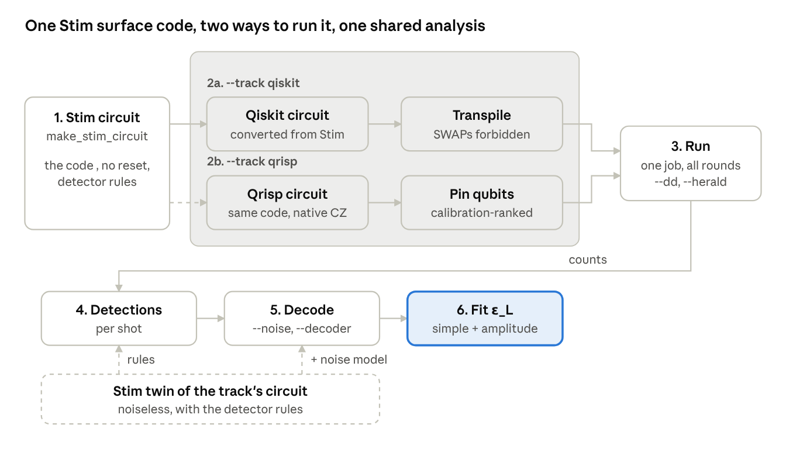
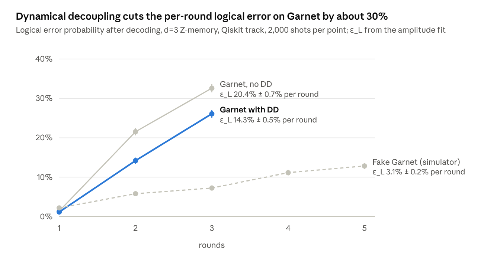

# Surface Code Pipeline: Step by Step

Oct 24, 2026

The pipeline stores one logical bit on 17 qubits, checks it for errors for a number of rounds, and reports how often the decoder still gets it wrong: the logical error rate per round, ε\_L.

## Overview



Step 1 defines the code in Stim. Step 2 builds the circuit that actually runs, in one of two ways: 2a (Qiskit) or 2b (Qrisp). Steps 3–6 are shared. Each track also provides a Stim twin of its circuit (noiseless, with the detector rules): it turns raw bits into detections (step 4) and, with a noise model added, tells the decoder which errors are likely (step 5).

| File | What it holds |
| --- | --- |
| `run_experiment.py` | The one command: runs every step for a list of round counts, fits, saves, plots |
| `tracks.py` | The two ways to build and run the circuit (`--track qiskit` / `qrisp`) |
| `surface_code.py` | Circuit generators: `make_stim_circuit`, `make_qiskit_circuit` (Qiskit track), `make_qrisp_experiment` (Qrisp track) |
| `noise_models.py` | The decoder's noise model (`--noise`) and the calibration snapshot format |
| `decoding.py` | Decoders (`--decoder`) and P\_error |
| `run_on_hardware.py` | Connecting to Resonance, calibration snapshot, the Qrisp hardware runner, `decode_hardware_results` for any saved run |
| `garnet_layout.py` | Qrisp track: calibration parser, zero-SWAP placement search, pinning pass |
| `stim_to_qiskit.py`, `extract_syndromes.py`, `internal_helpers.py` | Repo helpers used by the Qiskit track |
| `diagnose_run.py` | After a run: detector firing per round and which error type fits |
| `test_pipeline.py`, `check_surface_code.py` | Self-tests, no QPU time (both tracks; the second is the Qrisp branch's own) |
| `sweep.py`, `decoders.py` | The Qrisp branch's own sweep tool, kept working |

## Two tracks

Both tracks build the same d=3 rotated surface code without reset, on the same 17 Garnet qubits; they differ only in step 2 (2a or 2b). Steps 3–6 are shared.

|  | `--track qiskit` (default) | `--track qrisp` |
| --- | --- | --- |
| Circuit | Stim's standard circuit (CX + H), converted to Qiskit | Native CZ + one-pulse SQRT\_Y gates, tracking each data qubit's rotation |
| Placement | IQM's Qiskit transpiler finds a SWAP-free placement | Calibration-ranked search over every SWAP-free placement, pinned by hand |
| Between rounds | Compiler may merge gates across a readout | Barrier after every round's readout |
| Detection events | Stim's detector rules applied to the bits | Qrisp's post-processing of its parity checks |

The Stim **twin** of each track's circuit (noiseless, with the detector rules) is what steps 4–5 use; each track supplies its own, so the detector numbering always matches.

## 1. Stim: the surface code and its detector rules

`make_stim_circuit(distance, rounds, basis, no_reset, noise)` in `surface_code.py`

- **What it is:** the reference definition of the experiment, written in Stim: which qubits are data and which are checkers, the gates of each round, the measurements, and the `DETECTOR` / `OBSERVABLE_INCLUDE` rules (which measured bits to XOR).
- **No reset:** Stim's built-in rotated surface code measures and resets checkers (`MR`). Garnet can't reset mid-circuit, so every `MR` becomes `M` and every detector is rewritten so it still means "did this check change?": each checker reading becomes this reading XOR the previous one, which works out to m\_k ⊕ m\_(k−2).
- **Used for:** the circuit of track 2a; fast simulation (Stim samples many noisy shots in seconds); and, with noise added, the decoder's map in step 5.
- **Next:** step 2a or 2b.

## 2a. Qiskit track (`--track qiskit`, default)

`make_qiskit_circuit` in `surface_code.py` (using `stim_to_qiskit.py`), then `transpile` in `QiskitTrack.run` (`tracks.py`)

- **In:** the Stim circuit from step 1.
- **Does:**
  1. Converts it gate by gate to Qiskit (`H`, `CX`, `M`; for X-memory `RX` = reset + H and `MX` = H + measure) and drops the start-of-circuit resets, since qubits already start in 0. Measurement order stays exactly Stim's, so Stim's rules can read Qiskit's bits.
  2. Transpiles onto the chip: native gates (`r`, `cz`) and a physical qubit for each circuit qubit, with `routing_method="none"` so SWAPs are forbidden (it raises instead of adding one).
- **Out:** the circuit to run. It prints `CX=72 -> CZ=72`; equal counts confirm 0 SWAPs.
- **Twin for steps 4–5:** the Stim circuit from step 1 itself.
- **Next:** step 3.

## 2b. Qrisp track (`--track qrisp`)

`make_qrisp_experiment` in `surface_code.py`; placement and pinning in `garnet_layout.py` (from the Qrisp branch)

- **In:** the same settings (distance, rounds, basis). It is the same code as step 1, rebuilt natively in Qrisp rather than converted from Stim.
- **Does:**
  1. Writes each round with Garnet's native gates only: one-pulse SQRT\_Y rotations and CZ, in Stim's hook-safe CZ order. Each data qubit's rotation ("frame") is tracked, so it costs 2 pulses per data qubit per round. A barrier after every round's readout stops the compiler moving gates across it. Detectors are declared in the circuit (`parity(...)`) with the same m\_k ⊕ m\_(k−2) rule.
  2. Reads live calibration, scores every SWAP-free placement on Garnet (there is only one 17-qubit set; it leaves out QB3, QB17, QB18) and pins the circuit to the best one. The pass raises on any CZ that isn't on a native coupler.
- **Out:** the circuit to run, and Qrisp's post-processing function that turns raw bits into detections.
- **Twin for steps 4–5:** Qrisp exports a Stim copy of this circuit (`.to_stim()`), numbered like its detections.
- **Next:** step 3.

## 3. Run it

`track.run(...)` in `tracks.py` (Qrisp on hardware: `run_qrisp_batch` in `run_on_hardware.py`)

- **In:** one circuit per round count, a number of shots (e.g. 2,000), optional dynamical decoupling (`--dd`).
- **Does:** submits **all round counts as one job**, so they run back to back on the same calibration, then waits.
- **Out:** `counts` per circuit, a dictionary `{bitstring: times seen}`. Each bitstring holds every measurement of one shot, e.g. 33 bits for 3 rounds (8 ancillas × 3 + 9 data).
- **Next:** step 4. The raw counts are saved as soon as the job returns, so you can re-decode later without new QPU time.

## 4. Counts to detection events

Qiskit track: `counts_to_measurement_array()` then `extract_syndromes()`; Qrisp track: Qrisp's post-processing. Both in `tracks.py`.

- **In:** the counts, and the track's Stim twin (built with the same settings as the circuit that ran).
- **Does:** turns counts into a table (one row per shot, one column per measurement, Qiskit's reversed bit order fixed), then applies every `DETECTOR` and `OBSERVABLE_INCLUDE` rule: each is an XOR of a few bits.
- **Out:**
  - `det_events`: shots × detectors, `True` = that check reported a change (a hint that an error happened nearby).
  - `obs_flips`: shots × 1, `True` = the stored logical bit came out flipped.
- **Next:** step 5.

## 5. Decode

`noise_models.add_noise` then `decoding.logical_error`, called by `run_experiment.py` (`--noise`, `--decoder`)

- **In:** `det_events` and `obs_flips` from step 4, and the track's noiseless twin.
- **Does:**
  1. **Noise model** (`--noise`) adds the decoder's guess of the noise to a copy of the twin:
     - `uniform` (default): every gate, readout and idle period fails with 0.3%; `uniform:0.005` sets your own value.
     - `calibration`: per qubit, from the run's calibration snapshot: CZ and PRX errors, readout error, readout disturbance (1 − QNDness), and decay plus dephasing of idle qubits during each readout (echo T2 when `--dd` is on). Readout time is assumed to be 1.5 µs.
  2. Stim turns that copy into the detector error model (DEM): every possible error, how likely it is, which detectors it lights up, whether it flips the logical bit.
  3. **Decoder** (`--decoder`, default `pymatching`) predicts, per shot, whether the logical bit flipped. A shot is a logical error when the prediction disagrees with `obs_flips`.
- **Out:** `P_error` and its error bar, √(P(1−P)/shots), plus how often each detector fired.
- **Add your own:** a noise model is one `@register("name")` function in `noise_models.py`; a decoder is one `@register("name")` function in `decoding.py` taking `(det_events, dem)` and returning predictions, or any `module:function` passed to `--decoder`.
- **Decoding options.** Every option is minimum-weight perfect matching (PyMatching); they differ only in how likely the decoder thinks each error is, which changes the explanation it picks. All of them can re-decode saved shots with `--load results/<run>.json`, so comparisons use identical data.

| Option | Error weights | Result on saved Garnet shots |
| --- | --- | --- |
| no correction | none: just read the logical bit | the grey points in each plot, the baseline to beat |
| `--decoder pymatching --noise uniform` (default) | 0.3% for every gate, readout and idle period | the reference numbers |
| `--noise uniform:P` | your own single rate P | |
| `--noise calibration` | per qubit, from the run's calibration: CZ, PRX, readout, 1 − QNDness, full idle dephasing during readout | Qrisp 17:47 Z: 12.5% → 9.9% per round (amplitude fit) |
| `--decoder qubit_calibrated` | per qubit like `calibration`, but half the idle term (readout time is a guess); ignores `--noise` (`prepare_twin` in `decoding.py`) | Qrisp 17:47: Z 12.6% → 10.9%, X 9.9% → 9.6% (simple fit); with DD no change (7.9% Z, 7.3% X); Qiskit 20:17 DD: 14.3% → 14.7% (amplitude fit) |
| `--decoder module:function` | whatever your function does | |
| `sweep.py --decoder decoders:garnet_uniform` | Garnet's typical sizes: CZ 0.5%, readout 2%, a few % idle | worse: 8.3% → 8.8% (X), 8.6% → 8.8% (Z) |

- **Next:** step 6.

## 6. Repeat over rounds and fit the logical error rate

`run_experiment.py`

- **In:** a list of round counts (e.g. 1 2 3 4 5).
- **Does:** runs steps 1–5 for all of them (one job), saving as it goes, then fits P\_error against rounds two ways. Simple fit (the formula from the challenge README) assumes every round costs the same ε\_L:

```math
P_\text{error}(n) = \tfrac{1}{2}\left[1 - (1 - 2\varepsilon_L)^n\right]
```

- Amplitude fit: adds a factor A for the one-off cost of state preparation and final readout, so ε\_L is the cost of each extra round. On Garnet round 1 is far cheaper than later rounds, so this is the number to report. It needs at least 3 round counts:

```math
P_\text{error}(n) = \tfrac{1}{2}\left[1 - A\,(1 - 2\varepsilon_L)^n\right]
```

- **Out:**
  - ε\_L from both fits, with uncertainties.
  - `results/<name>.json`: settings (track, noise, decoder, DD), the calibration, and per round count: raw counts, P\_error, detector firing rate, which physical qubits were used.
  - `results/<name>_calibration.json`: the chip's error rates when the run started.
  - `results/<name>.png`: P\_error vs rounds with both fits.
- **Next:** `diagnose_run.py` on the JSON shows where the errors come from (either track).

## Results

On real Garnet, DD lowers the per-round logical error by about 30% in both tracks; even with DD each round after the first costs about 9–14%, against 3% on the simulator.



Every run had 0 SWAPs. Each pair of runs was taken back to back on the same qubits. Round 1 is far cheaper than later rounds, so the simple fit (one rate for every round) understates the cost of a round: it gives 5.6% → 4.3% for these runs. The amplitude fit separates the one-off first-round cost; with only 3 round counts per run, treat its error bars as optimistic.

The Qrisp track (teammate's branch, 17:47 and 17:50, 5,000 shots, rounds 1, 2, 3, 4, 6, 8) confirms it with more data:

| Qrisp track, amplitude fit | No DD | With DD | Change |
| --- | --- | --- | --- |
| Z-memory ε\_L per round | 12.6% ± 0.3% | 8.6% ± 0.2% | −32% |
| X-memory ε\_L per round | 11.0% ± 0.2% | 9.0% ± 0.2% | −18% |

The tracks differ at round 1 (Qiskit 1.4% vs Qrisp 13.3% P\_error, no DD) but the Qrisp circuit adds less error per later round. They were run 30 minutes apart, so a back-to-back `--track` comparison is still needed before calling either circuit better.

## What we learned

On real Garnet the code works for 1 round, then breaks at the first mid-circuit readout; DD cuts the per-round error by about 30% but doesn't fix it.

- **The pipeline is correct.** A noiseless simulation gives 0 detections and 0 logical errors for Z and X memory on both tracks, and fake Garnet behaves like a working code.
- **Zero SWAPs.** Qiskit track: the transpiler is not allowed to add SWAPs (`routing_method="none"`) and CX count = CZ count. Qrisp track: the circuit is pinned by hand and the compiler pass raises on any non-native CZ. Garnet has exactly one 17-qubit patch that fits the code (it skips QB3, QB17, QB18).
- **Round 1 works on hardware:** P\_error 1.1–1.4% on the Qiskit track, and decoding beats no correction about 6×.
- **From round 2 the checks fire 22–37% of the time** (round 1: about 7%). Error correction needs a few percent. Round 2 is the first round that follows a mid-circuit readout.
- **Why the readout hurts:**
  1. Readout takes about 1–2 µs; data qubits idle and lose phase (Ramsey T2 only 5–10 µs on Garnet).
  2. Measuring a checker disturbs it 2–5% of the time (IQM readout QNDness 0.95–0.98), and with no reset the error carries forward.
  3. Readout reports the wrong bit 2–5% of the time.
- **Report the amplitude fit, not the simple fit.** Round 1 is nearly free, so one rate for all rounds understates each round's cost about 3× (Qiskit track, no DD: 5.6% vs 20.4% per round).
- **DD helps but doesn't fix it.** Back to back on the same qubits: Qiskit track 20.4% → 14.3% per round, Qrisp track 12.6% → 8.6% (Z) and 11.0% → 9.0% (X). Round 1 is unchanged, as expected.
- **A better decoder can't rescue it.** Re-decoding with a fitted readout-idle noise model made P\_error slightly worse, and the Qrisp branch's "garnet\_uniform" weights also made it worse: the data is above the code's threshold.
- **Open question:** Z-checks fire about as often as X-checks on the Qiskit track, though idle dephasing should mostly trip X-checks. Likely the transpiler leaves some data qubits rotated while they idle; the Qrisp track tracks those rotations explicitly.

## Next steps

1. **Back-to-back track comparison:** `--track qiskit` then `--track qrisp`, same rounds, shots and DD setting, a few minutes apart. Tells whether the native-CZ circuit with barriers really adds less error per round.
2. **X-memory on Garnet** on the Qiskit track (`--basis X`), with and without DD.
3. **Calibration-weighted decoding:** run with `--noise calibration` and compare against `--noise uniform` on the same shots (`--load` re-decodes a saved file).
4. **Tiny diagnostic circuits:** one qubit measured twice (readout disturbance), and one data qubit idling while a neighbour is read out (idle decay).
5. **New decoders:** e.g. the union-find decoder from the `error_testing` branch, registered in `decoding.py`.
6. **Ask IQM mentors** whether mid-circuit reset or feedback is available; it would remove the no-reset problem.
7. **Emerald when it's back:** more qubits to choose from, and a chip-to-chip comparison.

## Commands

Set the token once per terminal (PowerShell: `$env:IQM_TOKEN = "..."`), never in a `.py` file.

In Command Prompt / Anaconda Prompt use `set IQM_TOKEN=...` with no quotes. Don't also pass the token in code: IQM's client refuses a token given both ways.

| Command | Uses QPU time? | What it does |
| --- | --- | --- |
| `python test_pipeline.py` | No | Checks both tracks: circuit, conversion, zero SWAPs, noise models, decoders |
| `python check_surface_code.py` | No | The Qrisp branch's self-test of its generator and Garnet placement |
| `python run_experiment.py --fake --rounds 1 2 3` | No | Full pipeline on IQM's local fake Garnet |
| `python run_experiment.py --qc garnet --rounds 1 2 3 4 6 8` | Yes | Real run; all round counts in one job |
| `python run_experiment.py --load results/<file>.json --noise calibration` | No | Re-decode a saved run (also `sweep.py` files, with `--basis`) |
| `python run_experiment.py --compare results/<A>.json results/<B>.json` | No | ε\_L of two runs side by side, and how many error bars apart |
| `python diagnose_run.py results/<file>.json` | No | Detector firing per round and which error type fits |

| Option | Default | What it does |
| --- | --- | --- |
| `--track qiskit\|qrisp` | `qiskit` | Step 2a or 2b |
| `--noise uniform\|uniform:P\|calibration` | `uniform` | The decoder's noise model |
| `--decoder NAME\|module:function` | `pymatching` | The decoder |
| `--qc NAME` | `garnet` | Quantum computer on Resonance |
| `--fake` | off | IQM's local fake Garnet instead of hardware (free, no token) |
| `--rounds N N …` | `1 2 3 4 5` | Round counts to run |
| `--shots N` | `2000` | Shots per round count |
| `--basis Z\|X` | `Z` | Z-memory (bit flips) or X-memory (phase flips) |
| `--dd` | off | IQM's dynamical decoupling (hardware only) |
| `--herald` | off | Drop shots where a qubit didn't start in 0 (hardware only) |
| `--load FILE` | none | Re-decode a saved run instead of running anything |
| `--compare A B` | none | Compare two saved runs and exit |
| `--distance N` | `3` | Code size; 5 needs 49 qubits (Emerald) |
| `--tag TEXT` | none | Extra label in the output file names |

On real hardware IQM's "circuit longer than T2" check is switched off, so 6–8 round runs aren't refused.

The Qrisp track also needs `networkx` (`pip install -r requirements.txt` installs it).
