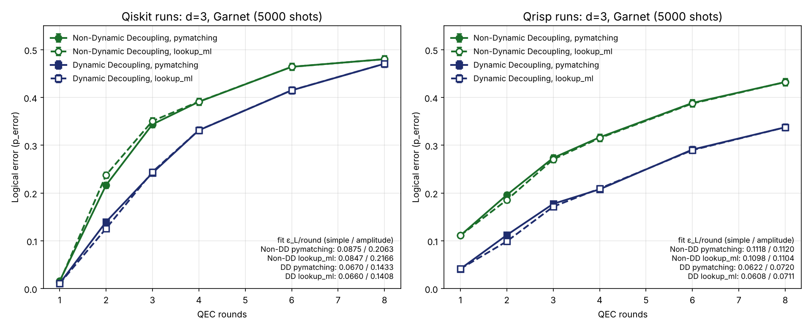

# Surface Code Pipeline: Step by Step

Oct 24–25, 2026

The pipeline stores one logical bit on 17 qubits, checks it for errors for a number of rounds, and reports how often the decoder still gets it wrong: the logical error rate per round, ε\_L.

## Overview


Step 1 defines the code in Stim. Step 2 builds the circuit that actually runs, in one of two ways: 2a (Qiskit) or 2b (Qrisp). Steps 3–6 are shared. Each track also provides a Stim twin of its circuit (noiseless, with the detector rules): it turns raw bits into detections (step 4) and, with a noise model added, tells the decoder which errors are likely (step 5).

| File | What it holds |
| --- | --- |
| `run_experiment.py` | The one command: runs every step for a list of round counts, fits, saves, plots |
| `tracks.py` | The two ways to build and run the circuit (`--track qiskit` / `qrisp`), qubit placement, `--allow-swaps` / `--exclude` |
| `surface_code.py` | Circuit generators: `make_stim_circuit`, `make_qiskit_circuit` (Qiskit track), `make_qrisp_experiment` (Qrisp track) |
| `noise_models.py` | The decoder's noise model (`--noise`) and the calibration snapshot format |
| `decoding.py` | Decoders (`--decoder`: `pymatching`, `qubit_calibrated`, `lookup_ml`) and P\_error |
| `run_on_hardware.py` | Connecting to Resonance, calibration snapshot, the Qrisp hardware runner, `decode_hardware_results` for any saved run |
| `garnet_layout.py` | Qrisp track: calibration parser, zero-SWAP placement search, pinning pass |
| `stim_to_qiskit.py`, `extract_syndromes.py`, `internal_helpers.py` | Repo helpers used by the Qiskit track |
| `diagnose_run.py` | After a run: detector firing per round and which error type fits |
| `plot_decoders.py` | Re-decodes saved runs with two decoders and plots them side by side (no QPU time) |
| `test_pipeline.py`, `check_surface_code.py` | Self-tests, no QPU time (both tracks; the second is the Qrisp branch's own) |
| `sweep.py`, `decoders.py` | The Qrisp branch's own sweep tool, kept working |

## Two tracks

Both tracks build the same d=3 rotated surface code without reset, on the same 17 Garnet qubits; they differ only in step 2 (2a or 2b). Steps 3–6 are shared.

|  | `--track qiskit` (default) | `--track qrisp` |
| --- | --- | --- |
| Circuit | Stim's standard circuit (CX + H), converted to Qiskit | Native CZ + one-pulse SQRT\_Y gates, tracking each data qubit's rotation |
| Placement | Qiskit's transpiler picks the SWAP-free placement with the lowest estimated error (IQM's backend supplies live gate fidelities on real hardware) | Scores every SWAP-free placement with live calibration (CZ, single-qubit, readout errors and T2) and pins the best one by hand |
| Avoiding bad qubits | `--exclude QB..`, `--allow-swaps`, `--optimize-qubits` (may add SWAPs) | Only SWAP-free placements |
| Between rounds | Compiler may merge gates across a readout | Barrier after every round's readout |
| Detection events | Stim's detector rules applied to the bits | Qrisp's post-processing of its parity checks |

The Stim **twin** of each track's circuit (noiseless, with the detector rules) is what steps 4–5 use; each track supplies its own, so the detector numbering always matches.

## 1. Stim: the surface code and its detector rules

`make_stim_circuit(distance, rounds, basis, no_reset, noise)` in `surface_code.py`

- **What it is:** the reference definition of the experiment, written in Stim: which qubits are data and which are checkers, the gates of each round, the measurements, and the `DETECTOR` / `OBSERVABLE_INCLUDE` rules (which measured bits to XOR).
- **No reset:** Stim's built-in rotated surface code measures and resets checkers (`MR`). Garnet can't reset mid-circuit, so every `MR` becomes `M` and every detector is rewritten so it still means "did this check change?": each checker reading becomes this reading XOR the previous one, which works out to m\_k ⊕ m\_(k−2).
- **Used for:** the circuit of track 2a; fast simulation (Stim samples many noisy shots in seconds); and, with noise added, the decoder's map in step 5.
- **Next:** step 2a or 2b.

## 2a. Qiskit track (`--track qiskit`, default)

`make_qiskit_circuit` in `surface_code.py` (using `stim_to_qiskit.py`), then `transpile` in `QiskitTrack.run` (`tracks.py`)

- **In:** the Stim circuit from step 1.
- **Does:**
  1. Converts it gate by gate to Qiskit (`H`, `CX`, `M`; for X-memory `RX` = reset + H and `MX` = H + measure) and drops the start-of-circuit resets, since qubits already start in 0. Measurement order stays exactly Stim's, so Stim's rules can read Qiskit's bits.
  2. Transpiles onto the chip: native gates (`r`, `cz`) and a physical qubit for each circuit qubit, with `routing_method="none"` so SWAPs are forbidden (it raises instead of adding one). If Qiskit's own placement search gives up (big codes, e.g. d=5 on Emerald), the track searches for a SWAP-free placement itself and passes it in.
  3. Prints the placement, e.g. `[qiskit] placement: data QB2 QB4 … | ancilla QB1 QB5 …`.
- **Out:** the circuit to run. It prints `CX=72 -> CZ=72` for 3 rounds (24 CNOTs per round: 4 middle checkers × 4 + 4 edge checkers × 2). Every CX compiles to exactly one CZ and each SWAP would add 3, so equal counts confirm 0 SWAPs.
- **When a bad qubit can't be avoided** (Garnet has only one SWAP-free 17-qubit patch, and it includes QB16):
  - `--exclude QB16`: never use that qubit; the transpiler routes around it with SWAPs.
  - `--allow-swaps`: only if no SWAP-free placement exists at all, let the transpiler add SWAPs (Sabre routing). The extra CZ count is printed and saved as `extra_cz`.
  - `--optimize-qubits`: run the normal placement, then repeatedly exclude the worst used qubit by calibration (readout error + 1 − QNDness + single-qubit error + its worst CZ) and run again, stopping as soon as the measured ε\_L gets worse, or after 3 exclusions. Summary in `results/optimize_qubits_<chip>_d3_<time>.json`. Each step is one QPU job.
  - Checked noiseless on fake Garnet: routing around QB16 costs about 4 SWAPs per round and still gives 0 detections and 0 logical errors.
- **Twin for steps 4–5:** the Stim circuit from step 1 itself.
- **Next:** step 3.

## 2b. Qrisp track (`--track qrisp`)

`make_qrisp_experiment` in `surface_code.py`; placement and pinning in `garnet_layout.py` (from the Qrisp branch)

- **In:** the same settings (distance, rounds, basis). It is the same code as step 1, rebuilt natively in Qrisp rather than converted from Stim.
- **Does:**
  1. Writes each round with Garnet's native gates only: one-pulse SQRT\_Y rotations and CZ, in Stim's hook-safe CZ order. Each data qubit's rotation ("frame") is tracked, so it costs 2 pulses per data qubit per round. A barrier after every round's readout stops the compiler moving gates across it. Detectors are declared in the circuit (`parity(...)`) with the same m\_k ⊕ m\_(k−2) rule.
  2. Reads live calibration, scores every SWAP-free placement on Garnet (there is only one 17-qubit set; it leaves out QB3, QB17, QB18) and pins the circuit to the best one. The pass raises on any CZ that isn't on a native coupler. The chosen placement is printed.
- **Out:** the circuit to run, and Qrisp's post-processing function that turns raw bits into detections.
- **Twin for steps 4–5:** Qrisp exports a Stim copy of this circuit (`.to_stim()`), numbered like its detections.
- **Next:** step 3.

## 3. Run it

`track.run(...)` in `tracks.py` (Qrisp on hardware: `run_qrisp_batch` in `run_on_hardware.py`)

- **In:** one circuit per round count, a number of shots (e.g. 2,000), optional dynamical decoupling (`--dd`).
- **Does:** submits **all round counts as one job**, so they run back to back on the same calibration, then waits.
- **Out:** `counts` per circuit, a dictionary `{bitstring: times seen}`. Each bitstring holds every measurement of one shot, e.g. 33 bits for 3 rounds (8 ancillas × 3 + 9 data).
- **Next:** step 4. The raw counts are saved as soon as the job returns, so you can re-decode later without new QPU time.

## 4. Counts to detection events

Qiskit track: `counts_to_measurement_array()` then `extract_syndromes()`; Qrisp track: Qrisp's post-processing. Both in `tracks.py`.

- **In:** the counts, and the track's Stim twin (built with the same settings as the circuit that ran).
- **Does:** turns counts into a table (one row per shot, one column per measurement, Qiskit's reversed bit order fixed), then applies every `DETECTOR` and `OBSERVABLE_INCLUDE` rule: each is an XOR of a few bits.
- **Out:**
  - `det_events`: shots × detectors, `True` = that check reported a change (a hint that an error happened nearby).
  - `obs_flips`: shots × 1, `True` = the stored logical bit came out flipped.
- **Next:** step 5.

## 5. Decode

`noise_models.add_noise` then `decoding.logical_error`, called by `run_experiment.py` (`--noise`, `--decoder`)

- **In:** `det_events` and `obs_flips` from step 4, and the track's noiseless twin.
- **Does:**
  1. **Noise model** (`--noise`) adds the decoder's guess of the noise to a copy of the twin:
     - `uniform` (default): every gate, readout and idle period fails with 0.3%; `uniform:0.005` sets your own value.
     - `calibration`: per qubit, from the run's calibration snapshot: CZ and PRX errors, readout error, readout disturbance (1 − QNDness), and decay plus dephasing of idle qubits during each readout (echo T2 when `--dd` is on). Readout time is assumed to be 1.5 µs.
  2. Stim turns that copy into the detector error model (DEM): every possible error, how likely it is, which detectors it lights up, whether it flips the logical bit.
  3. **Decoder** (`--decoder`, default `pymatching`) predicts, per shot, whether the logical bit flipped. A shot is a logical error when the prediction disagrees with `obs_flips`.
- **Out:** `P_error` and its error bar, √(P(1−P)/shots), plus how often each detector fired.
- **Add your own:** a noise model is one `@register("name")` function in `noise_models.py`; a decoder is one `@register("name")` function in `decoding.py` taking `(det_events, dem)` and returning predictions, or any `module:function` passed to `--decoder`.
- **Decoding options.** All but `lookup_ml` are minimum-weight perfect matching (PyMatching); they differ only in how likely the decoder thinks each error is, which changes the explanation it picks. `lookup_ml` is maximum-likelihood decoding. All of them can re-decode saved shots with `--load results/<run>.json`, so comparisons use identical data.

| Option | Error weights | Result on saved Garnet shots |
| --- | --- | --- |
| no correction | none: just read the logical bit | the grey points in each plot, the baseline to beat |
| `--decoder pymatching --noise uniform` (default) | 0.3% for every gate, readout and idle period | the reference numbers |
| `--noise uniform:P` | your own single rate P | |
| `--noise calibration` | per qubit, from the run's calibration: CZ, PRX, readout, 1 − QNDness, full idle dephasing during readout | Qrisp 17:47 Z: 12.5% → 9.9% per round (amplitude fit) |
| `--decoder qubit_calibrated` | per qubit like `calibration`, but half the idle term (readout time is a guess); ignores `--noise` (`prepare_twin` in `decoding.py`) | Qrisp 17:47: Z 12.6% → 10.9%, X 9.9% → 9.6% (simple fit); with DD no change (7.9% Z, 7.3% X); Qiskit 20:17 DD: 14.3% → 14.7% (amplitude fit) |
| `--decoder lookup_ml` | maximum likelihood by lookup table: for every detector pattern, the more likely logical value under `--noise`. Exact for ≤ 2 rounds (computed from the DEM); for 3+ rounds estimated from 1M simulated shots, falling back to matching for unseen patterns | Simulated noise: always beats matching (2 rounds: 4.5% → 4.1% Z, 4.9% → 4.3% X). Garnet 20:17–20:22 runs: 0.1–0.3 points better in all four (simple fit), within 1–3 error bars |
| `--decoder module:function` | whatever your function does | |
| `sweep.py --decoder decoders:garnet_uniform` | Garnet's typical sizes: CZ 0.5%, readout 2%, a few % idle | worse: 8.3% → 8.8% (X), 8.6% → 8.8% (Z) |

- **Next:** step 6.

## 6. Repeat over rounds and fit the logical error rate

`run_experiment.py`

- **In:** a list of round counts (e.g. 1 2 3 4 5).
- **Does:** runs steps 1–5 for all of them (one job), saving as it goes, then fits P\_error against rounds two ways. Simple fit (the formula from the challenge README) assumes every round costs the same ε\_L:

```math
P_\text{error}(n) = \tfrac{1}{2}\left[1 - (1 - 2\varepsilon_L)^n\right]
```

- Amplitude fit: adds a factor A for the one-off cost of state preparation and final readout, so ε\_L is the cost of each extra round. On Garnet round 1 is far cheaper than later rounds, so this is the number to report. It needs at least 3 round counts:

```math
P_\text{error}(n) = \tfrac{1}{2}\left[1 - A\,(1 - 2\varepsilon_L)^n\right]
```

- **Out:**
  - ε\_L from both fits, with uncertainties.
  - `results/<name>.json`: settings (track, noise, decoder, DD), the calibration, and per round count: raw counts, P\_error, detector firing rate, which physical qubits were used.
  - `results/<name>_calibration.json`: the chip's error rates when the run started.
  - `results/<name>.png`: P\_error vs rounds with both fits.
- **Next:** `diagnose_run.py` on the JSON shows where the errors come from (either track).

## Results

**Back-to-back runs, Oct 24 20:17–20:22** (same calibration, both tracks, with and without DD, 5,000 shots, rounds 1, 2, 3, 4, 6, 8, Z-memory, 0 SWAPs):

| ε\_L per round | Qiskit, no DD | Qiskit, DD | Qrisp, no DD | Qrisp, DD |
| --- | --- | --- | --- | --- |
| Amplitude fit (report this) | 20.6% ± 0.4% | 14.3% ± 0.2% | 11.2% ± 0.3% | 7.2% ± 0.2% |
| Simple fit | 8.75% | 6.70% | 11.18% | 6.22% |
| P\_error at 1 round | 1.6% | 1.1% | 11.1% | 4.1% |

- **DD** cuts the per-round error by about a third on both tracks (Qiskit −31%, Qrisp −36%). Round 1 barely changes.
- **Qiskit vs Qrisp:** the Qrisp circuit (native CZ, barriers after each readout, tracked frames) adds much less error per round after the first, but pays a large one-off cost at round 1. The Qiskit circuit is nearly perfect for 1 round, because all 17 measurements happen together at the end, and then degrades fast.

Decoders compared on the same shots (solid = pymatching, dashed = maximum-likelihood `lookup_ml`):



The maximum-likelihood decoder is 0.1–0.3 points better per round in all four runs (simple fit), within 1–3 error bars. Matching is already close to optimal for the noise model, so the remaining error comes from the hardware.

**Calibration drift (Oct 25):** overnight QB16 degraded (CZ with QB11 1.0% → 8.8%, with QB15 1.0% → 5.7%, single-qubit error 0.07% → 3.8%, T2 6.7 → 2.4 µs). QB16 is part of Garnet's only SWAP-free patch, so every run uses it: the Oct 25 Qiskit DD run gave 15.6% (amplitude) vs 14.3% the evening before. This is the case `--optimize-qubits` / `--exclude QB16` is for.

**First runs, Oct 24 17:12–17:50** (2,000 shots, rounds 1–3 for Qiskit; the teammate's Qrisp branch with rounds 1–8):


| Qrisp track, amplitude fit | No DD | With DD | Change |
| --- | --- | --- | --- |
| Z-memory ε\_L per round | 12.6% ± 0.3% | 8.6% ± 0.2% | −32% |
| X-memory ε\_L per round | 11.0% ± 0.2% | 9.0% ± 0.2% | −18% |

## What we learned

On real Garnet the code works for 1 round, then breaks at the first mid-circuit readout; DD cuts the per-round error by about a third but doesn't fix it.

- **The pipeline is correct.** A noiseless simulation gives 0 detections and 0 logical errors for Z and X memory on both tracks, and fake Garnet behaves like a working code.
- **Zero SWAPs.** Qiskit track: the transpiler is not allowed to add SWAPs (`routing_method="none"`) and CX count = CZ count. Qrisp track: the circuit is pinned by hand and the compiler pass raises on any non-native CZ. Garnet has exactly one 17-qubit patch that fits the code (it skips QB3, QB17, QB18).
- **Round 1 works on hardware:** P\_error 1.1–1.4% on the Qiskit track, and decoding beats no correction about 6×.
- **From round 2 the checks fire 22–37% of the time** (round 1: about 7%). Error correction needs a few percent. Round 2 is the first round that follows a mid-circuit readout.
- **Why the readout hurts:**
  1. Readout takes about 1–2 µs; data qubits idle and lose phase (Ramsey T2 only 5–10 µs on Garnet).
  2. Measuring a checker disturbs it 2–5% of the time (IQM readout QNDness 0.95–0.98), and with no reset the error carries forward.
  3. Readout reports the wrong bit 2–5% of the time.
- **Report the amplitude fit, not the simple fit.** On the Qiskit track round 1 is nearly free, so one rate for all rounds understates each round's cost more than 2× (no DD: 8.75% simple vs 20.6% amplitude).
- **DD helps but doesn't fix it.** Back to back on the same qubits: Qiskit track 20.6% → 14.3% per round, Qrisp track 11.2% → 7.2% (Z). Round 1 barely changes, as expected.
- **The two circuits trade off differently.** Qiskit: excellent round 1, then about 2× more error per round than Qrisp. Qrisp: barriers and tracked frames make later rounds cheaper, at a one-off round-1 cost.
- **A better decoder can't rescue it.** Even maximum-likelihood decoding (`lookup_ml`) only gains 0.1–0.3 points per round over matching, and the calibration-weighted decoders gain little or nothing with DD: the data is above the code's threshold.
- **The chip drifts.** Calibration changes between runs (QB16 overnight), so compare settings only on back-to-back runs.
- **Avoiding a bad qubit isn't free.** On Garnet it means SWAPs every round (about 4 per round to skip QB16), each costing 3 CZs; `--optimize-qubits` measures whether that pays off.
- **Open question:** Z-checks fire about as often as X-checks on the Qiskit track, though idle dephasing should mostly trip X-checks. Likely the transpiler leaves some data qubits rotated while they idle; the Qrisp track tracks those rotations explicitly.

## Next steps

1. **Mid-circuit reset, if IQM enables it.** With no reset every readout error shows up in two detectors (m\_k ⊕ m\_(k−2)) and checker disturbances carry forward; reset removes both.
2. **Emerald (54 qubits):** many SWAP-free placements, so a calibration-ranked choice actually matters, bad qubits can be avoided without SWAPs, and d=5 becomes possible. Distance scaling Λ = ε\_L(d=3) / ε\_L(d=5) is the standard test of whether the chip is below threshold.
3. **`--optimize-qubits` on Garnet with QB16 degraded:** does routing around it with SWAPs beat using it?
4. **Learn the decoder's error model from the data:** estimate each error's probability from how often detector pairs fire together in the hardware shots, instead of guessing a noise model.
5. **Exact maximum likelihood for more rounds:** tensor-network decoding contracts the probabilities piece by piece instead of building the full 2^(detectors) table.
6. **Back-to-back X-memory** on both tracks, with and without DD.
7. **Code adapted to dead qubits:** drop a broken qubit and merge its neighbouring checks into one larger check, instead of SWAPs.

## Commands

Set the token once per terminal (PowerShell: `$env:IQM_TOKEN = "..."`), never in a `.py` file.

In Command Prompt / Anaconda Prompt use `set IQM_TOKEN=...` with no quotes. Don't also pass the token in code: IQM's client refuses a token given both ways.

| Command | Uses QPU time? | What it does |
| --- | --- | --- |
| `python test_pipeline.py` | No | Checks both tracks: circuit, conversion, zero SWAPs, noise models, decoders |
| `python check_surface_code.py` | No | The Qrisp branch's self-test of its generator and Garnet placement |
| `python run_experiment.py --fake --rounds 1 2 3` | No | Full pipeline on IQM's local fake Garnet |
| `python run_experiment.py --qc garnet --rounds 1 2 3 4 6 8` | Yes | Real run; all round counts in one job |
| `python run_experiment.py --load results/<file>.json --noise calibration` | No | Re-decode a saved run (also `sweep.py` files, with `--basis`) |
| `python run_experiment.py --compare results/<A>.json results/<B>.json` | No | ε\_L of two runs side by side, and how many error bars apart |
| `python diagnose_run.py results/<file>.json` | No | Detector firing per round and which error type fits |
| `python run_experiment.py --qc garnet --rounds 1 2 3 4 --dd --optimize-qubits` | Yes, one job per step | Exclude the worst qubit step by step until ε\_L stops improving |
| `python plot_decoders.py --panel "Qiskit runs" <noDD>.json <DD>.json --panel "Qrisp runs" <noDD>.json <DD>.json` | No | Two decoders side by side on saved runs (default pymatching vs lookup\_ml) |

| Option | Default | What it does |
| --- | --- | --- |
| `--track qiskit\|qrisp` | `qiskit` | Step 2a or 2b |
| `--noise uniform\|uniform:P\|calibration` | `uniform` | The decoder's noise model |
| `--decoder NAME\|module:function` | `pymatching` | The decoder: `pymatching`, `qubit_calibrated`, `lookup_ml`, or your own |
| `--qc NAME` | `garnet` | Quantum computer on Resonance |
| `--fake` | off | IQM's local fake Garnet instead of hardware (free, no token) |
| `--rounds N N …` | `1 2 3 4 5` | Round counts to run |
| `--shots N` | `2000` | Shots per round count |
| `--basis Z\|X` | `Z` | Z-memory (bit flips) or X-memory (phase flips) |
| `--dd` | off | IQM's dynamical decoupling (hardware only) |
| `--herald` | off | Drop shots where a qubit didn't start in 0 (hardware only) |
| `--allow-swaps` | off | Qiskit track: if no SWAP-free placement exists, let the transpiler add SWAPs |
| `--exclude QB..` | none | Qiskit track: never use these qubits (adds SWAPs if needed) |
| `--optimize-qubits` | off | Qiskit track: rerun excluding the worst qubit until ε\_L stops improving (at most 3 exclusions) |
| `--load FILE` | none | Re-decode a saved run instead of running anything |
| `--compare A B` | none | Compare two saved runs and exit |
| `--distance N` | `3` | Side length of the N×N grid of data qubits; uses 2N²−1 qubits (17 for 3, 49 for 5, which needs Emerald) |
| `--tag TEXT` | none | Extra label in the output file names |

On real hardware IQM's "circuit longer than T2" check is switched off, so 6–8 round runs aren't refused.

The Qrisp track also needs `networkx` (`pip install -r requirements.txt` installs it).
